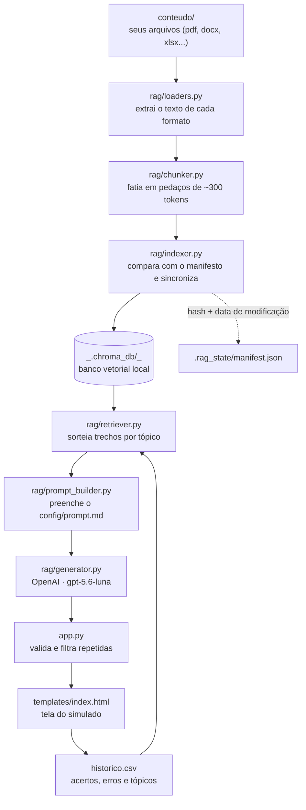

# 🎓 Simulador RAG — simulados de qualquer assunto, a partir dos seus arquivos

Você joga seus PDFs, Words, Excels, TXTs e Markdowns numa pasta. O programa lê tudo,
monta uma base de busca local e usa IA para gerar simulados de múltipla escolha
**baseados no seu próprio material** — com correção na hora, explicação da resposta e
histórico do seu desempenho.

Funciona para qualquer conteúdo: concurso, faculdade, certificação técnica, manual
interno da empresa, apostila de curso, o que você colocar na pasta.

> Projeto derivado do simulador AI-901 de [andradeyghor/ai901_agent](https://github.com/andradeyghor/ai901_agent),
> generalizado para qualquer conteúdo e migrado para a API da OpenAI (`gpt-5.6-luna`).

---

## ✨ O que ele faz

| Recurso | Como funciona |
|---|---|
| **Qualquer formato** | PDF, DOCX, DOC, TXT, MD, XLSX, XLS, CSV, TSV, PPTX, HTML, JSON, RST |
| **Base sempre em dia** | Ao rodar o simulado, ele compara a pasta com o que já está indexado: arquivo novo entra, arquivo apagado sai, arquivo editado é reprocessado — sem comando nenhum |
| **Tópicos automáticos** | Cada subpasta de `conteudo/` vira um tópico do simulado |
| **Equilíbrio inteligente** | Os tópicos que você menos praticou (ou em que vai pior) aparecem mais |
| **Nada de questão repetida** | Filtro exato + filtro semântico: se o modelo reescrever a mesma pergunta com outras palavras, ela é descartada |
| **Prompt editável** | Todo o "jeito" das questões está em `config/prompt.md`, em português, sem código |
| **Barato** | `gpt-5.6-luna` custa US$ 0,20 por milhão de tokens de entrada e US$ 1,20 de saída — um lote de 5 questões sai por alguns centésimos de centavo. Os embeddings rodam locais, de graça |
| **Histórico** | Toda resposta vai para `historico.csv` (abre no Excel) |

---

## 🚀 Começando em 3 comandos

```powershell
.\setup.ps1     # instala tudo e pede sua chave da OpenAI (uma vez só)
# copie seus arquivos de estudo para a pasta conteudo\
.\run.ps1       # abre o simulado em http://127.0.0.1:5000
```

Se o Windows bloquear a execução do script:

```powershell
Set-ExecutionPolicy -Scope Process -ExecutionPolicy Bypass
```

O passo a passo detalhado está em **[TUTORIAL.md](TUTORIAL.md)**.

---

## 🏛️ Como funciona por dentro



### A sincronização automática (o coração do projeto)

Toda vez que você pede um lote de questões, o `app.py` faz uma checagem **instantânea**
da pasta: compara nome, tamanho e data de modificação de cada arquivo com o que está
registrado em `.rag_state/manifest.json`.

- Nada mudou → segue direto para a geração (custo zero de tempo).
- Algo mudou → só então o arquivo suspeito tem o **hash SHA-256** calculado, para
  confirmar que o conteúdo mudou de verdade (e não só a data).

O que acontece em cada caso:

| Situação | O que o programa faz |
|---|---|
| Você **adicionou** um arquivo | Lê, fatia, gera os vetores e insere na base |
| Você **apagou** um arquivo | Remove da base todos os pedaços daquele arquivo |
| Você **editou** um arquivo | Apaga os pedaços antigos e insere os novos |
| Você **renomeou/moveu** | Trata como remoção + inclusão (o tópico acompanha a pasta nova) |
| Você trocou o modelo de embedding ou o tamanho dos chunks no `settings.json` | Reconstrói a base inteira automaticamente |

---

## 📂 Estrutura de pastas

```text
simulator/
├── conteudo/               ← 📌 VOCÊ JOGA SEUS ARQUIVOS AQUI
│   ├── Direito/            ← cada subpasta vira um tópico do simulado
│   └── Português/
│
├── config/
│   ├── prompt.md           ← 📌 O PROMPT, EM PORTUGUÊS E FÁCIL DE EDITAR
│   └── settings.json       ← modelo, nº de questões, idioma, custos...
│
├── rag/
│   ├── config.py           # caminhos + leitura do settings.json
│   ├── loaders.py          # lê pdf, docx, xlsx, csv, pptx, html...
│   ├── chunker.py          # fatia o texto em pedaços
│   ├── indexer.py          # sincroniza a pasta com a base vetorial
│   ├── retriever.py        # busca/sorteia os trechos de cada rodada
│   ├── generator.py        # fala com a OpenAI (gpt-5.6-luna)
│   └── prompt_builder.py   # preenche as variáveis do prompt.md
│
├── templates/index.html    # a tela do simulado (HTML/CSS/JS puro)
├── app.py                  # servidor: junta tudo e roda o simulado
├── setup.ps1               # instala tudo (rode uma vez)
├── run.ps1                 # inicia o simulado
├── requirements.txt        # bibliotecas usadas
├── .env                    # sua chave da OpenAI (criado pelo setup)
│
├── historico.csv           # gerado: suas respostas
├── .rag_state/manifest.json# gerado: controle do que já foi indexado
└── .chroma_db/             # gerado: o banco vetorial
```

---

## ✏️ Editando o prompt (`config/prompt.md`)

O arquivo tem duas seções. Tudo que estiver fora delas é ignorado (serve de anotação):

```markdown
## PROMPT DO SISTEMA
(as regras gerais do examinador: tom, rigor, idioma, estilo)

## PROMPT DO USUÁRIO
(o pedido de cada rodada: quantas questões, sobre o quê, com qual formato)
```

Dentro do texto você usa variáveis entre chaves duplas:

| Variável | Vira |
|---|---|
| `{{numero_questoes}}` | número de questões do lote |
| `{{numero_opcoes}}` | número de alternativas |
| `{{letras}}` | `A, B, C, D, E` |
| `{{idioma}}` | idioma configurado |
| `{{topicos}}` | os tópicos sorteados na rodada |
| `{{contexto}}` | os trechos dos seus arquivos (RAG) |
| `{{perguntas_anteriores}}` | questões já feitas, para não repetir |
| `{{formato_json}}` | o formato de resposta exigido |
| `{{instrucoes_extras}}` | texto livre vindo do `settings.json` |
| `{{data}}` | data de hoje |

Quer criar a sua? Coloque a chave em `variaveis_prompt` no `settings.json` e use
`{{sua_chave}}` no prompt.

> **Não precisa reiniciar nada.** O prompt é relido a cada lote: salve o arquivo e clique
> em "Gerar próximas questões".

**Exemplos de personalização:**

- Quer questões no estilo de uma banca? Acrescente na seção do sistema:
  *"Use o estilo da banca CESPE: afirmações longas, uma única ideia por alternativa."*
- Quer que cite a fonte? Peça: *"Ao final da explicação, cite o nome do arquivo e a seção de onde saiu a informação."*
- Quer questões só de um tipo? *"Todas as questões devem ser casos práticos, começando com uma situação real de trabalho."*

---

## ⚙️ Configurações (`config/settings.json`)

JSON não aceita comentários, então as explicações estão nas chaves `_ajuda`
(o programa ignora tudo que começa com `_`).

### `titulo`
Nome que aparece no topo da tela.

### `conteudo`
| Chave | Padrão | O que faz |
|---|---|---|
| `pasta` | `"conteudo"` | Onde ficam os seus arquivos |
| `topico_por` | `"pasta"` | `pasta` = o tópico é o nome da subpasta; `arquivo` = o tópico é o nome do arquivo |
| `ignorar` | `["~$*", ".*", ...]` | Padrões de nome ignorados (o `~$*` pega os temporários do Office) |

### `rag`
| Chave | Padrão | O que faz |
|---|---|---|
| `modelo_embedding` | `paraphrase-multilingual-MiniLM-L12-v2` | Modelo local de busca (funciona em português). **Trocar reconstrói a base** |
| `chunk_alvo_tokens` | `300` | Tamanho de cada pedaço de texto |
| `chunk_max_tokens` | `450` | Teto de um pedaço |
| `trechos_por_topico` | `2` | Quantos trechos sorteados por tópico vão para o prompt |
| `vizinhos_por_trecho` | `2` | Quantos trechos parecidos acompanham cada sorteado |

Mais trechos = questões mais ricas e mais caras. Menos trechos = mais barato e mais focado.

### `llm`
| Chave | Padrão | O que faz |
|---|---|---|
| `modelo` | `"gpt-5.6-luna"` | Modelo usado para escrever as questões |
| `base_url` | `""` | Vazio = OpenAI oficial. Preencha para usar OpenRouter, DeepSeek, Ollama etc. |
| `api_key_env` | `"OPENAI_API_KEY"` | Nome da variável no `.env` |
| `reasoning_effort` | `"low"` | `none`/`low`/`medium`/`high` — mais raciocínio = questões melhores, porém mais caras e lentas |
| `max_completion_tokens` | `8000` | Espaço máximo da resposta |
| `temperature` e penalidades | `null` | **A família gpt-5.6 não aceita esses parâmetros.** Só preencha se trocar por um modelo antigo (ex.: `gpt-4o-mini`) |
| `preco_*_por_milhao` | `0.20` / `1.20` | Usados só para mostrar o custo estimado na tela |

> Se a API recusar algum parâmetro, o `generator.py` remove o parâmetro citado no erro e
> tenta de novo sozinho — por isso trocar de modelo raramente quebra alguma coisa.

### `simulado`
| Chave | Padrão | O que faz |
|---|---|---|
| `questoes_por_lote` | `8` | Questões por rodada (o front aceita de 1 a 30) |
| `opcoes_por_questao` | `5` | Alternativas por questão (2 a 8) |
| `idioma` | `"portugues do Brasil"` | Idioma das questões |
| `instrucoes_extras` | `""` | Texto livre injetado no prompt |
| `limiar_duplicata` | `0.85` | 0 a 1. Menor = mais rigoroso contra questões parecidas |
| `permitir_sem_conteudo` | `false` | `true` deixa gerar simulado mesmo com a pasta vazia, usando `tema_livre` |

---

## 🖥️ Comandos úteis

```powershell
.\run.ps1                 # inicia o simulado
.\run.ps1 -Status         # mostra arquivos, tópicos e trechos já indexados
.\run.ps1 -Reindexar      # apaga a base e reconstrói do zero

# equivalentes sem o PowerShell (com o .venv ativado):
python app.py
python -m rag.indexer --status
python -m rag.indexer --rebuild
python -m rag.retriever --query "teste de busca na base"
```

---

## 🧯 Problemas comuns

| Sintoma | Causa e solução |
|---|---|
| **"A chave da API não foi encontrada"** | O arquivo `.env` não existe ou está com o texto de exemplo. Abra e escreva `OPENAI_API_KEY=sk-...` |
| **"A base de conhecimento está vazia"** | Não há arquivos suportados em `conteudo/`. Copie seus PDFs para lá e clique em "↻ atualizar base" |
| **Um PDF aparece como "com erro"** | PDF escaneado (é imagem, não texto). Precisa passar por OCR antes, ou use outra versão do arquivo |
| **`.doc` não é lido** | Formato antigo do Word: precisa do Word instalado. O mais simples é abrir e salvar como `.docx` |
| **"o modelo ficou sem espaço para responder"** | Aumente `max_completion_tokens` ou baixe `questoes_por_lote` no `settings.json` |
| **Questões repetidas** | Baixe o `limiar_duplicata` (ex.: `0.78`) e adicione mais material na pasta |
| **Questões genéricas demais** | O material tem poucos trechos. Aumente `trechos_por_topico`, ou coloque conteúdo mais detalhado |
| **Windows bloqueia o `.ps1`** | `Set-ExecutionPolicy -Scope Process -ExecutionPolicy Bypass` e rode de novo |
| **Quero começar o histórico do zero** | Apague o `historico.csv` |
| **Quero recomeçar a base** | `.\run.ps1 -Reindexar` |

---

## 💰 Quanto custa

- **Embeddings (busca):** roda na sua máquina, custo zero.
- **Geração das questões:** `gpt-5.6-luna` a US$ 0,20 por 1M de tokens de entrada e
  US$ 1,20 por 1M de saída. Um lote de 5 questões com contexto costuma ficar em torno de
  3–6 mil tokens de entrada e 2–3 mil de saída — algo como **US$ 0,004 por lote**
  (uns 2 centavos de real). O rodapé da tela mostra o custo estimado de cada rodada.

---

## 📄 Licença

MIT — veja [LICENSE](LICENSE).
